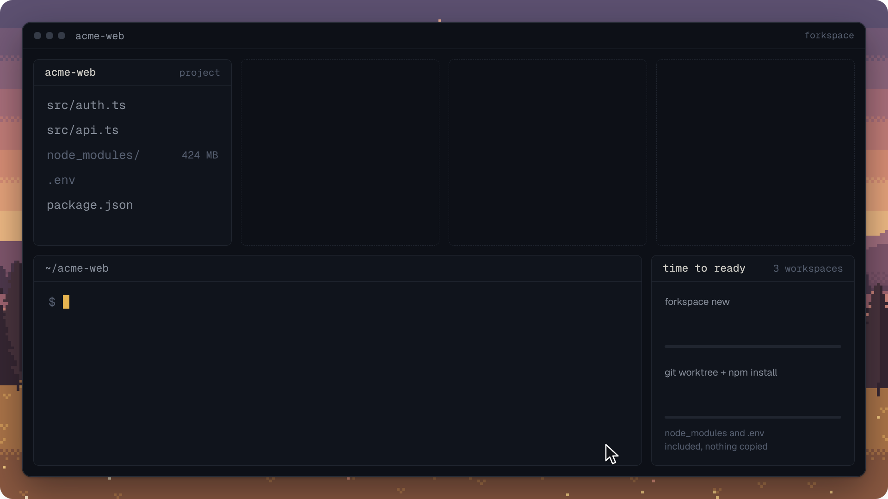
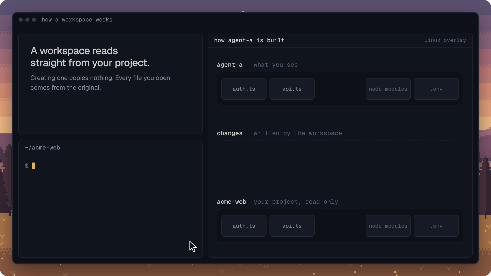
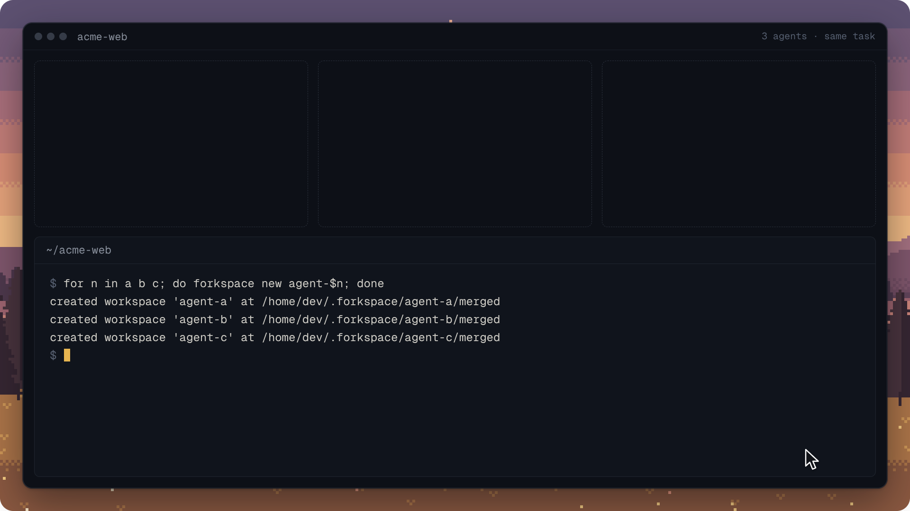
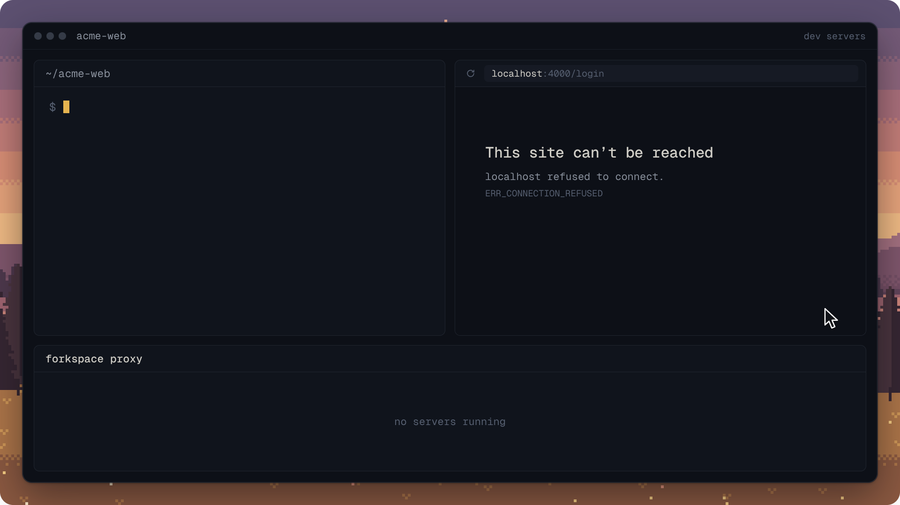

<h1 align="center">
  <picture>
    <source media="(prefers-color-scheme: dark)" srcset="assets/logo/logo-dark.svg" />
    
  </picture>
</h1>

<p align="center">
  <strong>Throwaway copies of your whole project, for agents, experiments and parallel work.</strong><br />
  Try anything in a copy, then keep it or throw it away. Your project is not touched until you say so.
</p>

<p align="center">
  <a href="https://crates.io/crates/forkspace"></a>
  <a href="LICENSE"></a>
  <a href="#platforms"></a>
  <a href="#install"></a>
</p>

<p align="center">
  <br />
  <sub>Timings measured on a Next.js 15 app with a 424 MB <code>node_modules</code>. <a href="docs/benchmarks.md#measured-linux-overlay-on-a-real-project">How</a>.</sub>
</p>

## Why forkspace?

A workspace is a full copy of your project, including the files Git ignores: `node_modules`,
build caches, `.env`. Change anything in it; your project stays exactly as it was until you
merge. Making a workspace is fast because forkspace uses the cheapest copy your computer
offers, and on most machines unchanged files take no extra disk space.

|                         |  `cp -r`  |  Docker   | Git worktree |   **forkspace**   |
| :---------------------- | :-------: | :-------: | :----------: | :-----------: |
| **Speed**               |   Slow    |   Slow    |     Fast     | [**Fast**](docs/benchmarks.md) |
| `.env` / `node_modules` |    Yes    |    No     |      No      | [**Yes**](docs/platform-parity.md) |
| **Isolation**           |   Full    |   Full    |   Partial    | [**Project-local**](docs/platform-parity.md#limitations) |
| **Disk usage**          | Full copy | Full copy |   Partial    | [**Shared until changed**](docs/platform-parity.md) |
| **Root required**       |    No     |   Often   |      No      | [**No**](docs/platform-parity.md) |
| **Cleanup**             |  Manual   |  Manual   |    Manual    | [`forkspace drop`](docs/cli-reference.md#forkspace-drop-names) |

## Quick start

In your project folder:

```bash
forkspace new try-it                 # a copy of the project you are in
forkspace enter try-it -- sh -c 'echo "new idea" >> file.txt'

forkspace diff try-it                # what changed
forkspace merge try-it               # put the changes into your project
forkspace undo                       # changed your mind: take them back out
forkspace drop try-it                # throw the copy away
```

`forkspace enter try-it` without a command opens a shell inside the workspace. Inside a
workspace you can leave out its name: `forkspace diff`, `forkspace merge`. Without a name,
`new` calls the workspace after your project: `shop-1`, `shop-2`, and so on.

## Install

<!-- notest: installation is networked; docs CI installs this checkout with cargo install --path -->
```bash
# a prebuilt binary for Linux or macOS (x86_64 or arm64), into ~/.local/bin
curl -fsSL https://github.com/berezovyy/forkspace/releases/latest/download/install.sh | sh

# or build it from source with Cargo
cargo install forkspace

# let Claude Code use forkspace for its worktrees (safe to run again)
forkspace setup

# later: move to the newest release
forkspace upgrade
```

Forkspace runs on Linux and macOS and needs no root or daemon. On Linux, install
[`fuse-overlayfs`](https://github.com/containers/fuse-overlayfs) for instant workspaces.
`forkspace upgrade` replaces a downloaded binary in place, and a Cargo install through Cargo;
workspaces made by an older version keep working. Releases and their notes are on the
[releases page](https://github.com/berezovyy/forkspace/releases), and in
[CHANGELOG.md](CHANGELOG.md).

## Working with Git

In a Git project, every workspace is on its own branch, named after the workspace. Work
there as usual: edit, run the tests, commit as often as you like.

- `forkspace merge` puts the workspace's changed files into your project, where `git diff`
  and `git status` show them and you commit them as you like. The workspace's commits are
  kept as the project branch of the same name (`shop-1`); the branch you have checked out
  never moves.
- `forkspace pull` brings what changed in your project since then into the workspace, line
  by line where both sides changed one file.
- `forkspace undo` puts your project, and that branch, back as they were before the merge.
- `forkspace drop` throws the workspace away. It warns when the workspace made commits that
  were never merged.

## How it works

<p align="center">
  
</p>

On Linux with `fuse-overlayfs`, a workspace copies nothing when it is made. It reads from a
copy of your project that forkspace keeps (made once per project, and shared by all of its
workspaces), and keeps what you change in a separate place. That is why `diff` is instant,
`merge` knows exactly what to bring back, and a branch switch in your project never reaches
a workspace that is running an agent.

On macOS (APFS) and on Linux file systems that can clone files (Btrfs, XFS), a workspace is an
ordinary folder whose files share disk space with your project until they are changed.
Anywhere else, it is a plain copy, and `new` says so. The commands and their output are the
same everywhere; see [Platforms](#platforms).

## Where to use it

### Parallel AI agents

<p align="center">
  
</p>

Give each agent its own workspace of the same repository. They can install packages, run
tests and edit the same files without stepping on each other or on you. When they are done,
compare the attempts and keep the best one.

```bash
for n in a b c; do forkspace new agent-$n; done

# Start one agent per workspace, e.g. `forkspace enter agent-a -- <your agent>`.
forkspace enter agent-a -- sh -c 'echo "export const otp = true;" > src/otp.ts'

forkspace diff agent-a agent-b agent-c   # what each attempt touched
forkspace merge agent-a                  # keep one
forkspace drop agent-b agent-c           # throw the rest away
```

`forkspace setup` teaches Claude Code to use forkspace: it installs the forkspace skill and
makes Claude Code's own worktrees (`claude --worktree`, subagents with
`isolation: worktree`) forkspace workspaces, with `node_modules` and `.env` already inside.

### Dev servers side by side

<p align="center">
  
</p>

Each workspace runs its own dev server on its own port. `localhost:4000` shows whichever one
you switch to, so you can compare branches in one browser tab without restarting anything.

<!-- notest: starts long-running host services; the proxy integration suite executes this lifecycle -->
```bash
forkspace new feature-a
forkspace new feature-b

forkspace run feature-a -- npm run dev    # gets $PORT=3000
forkspace run feature-b -- npm run dev    # 3000 is taken: gets a free port from 5501

forkspace switch feature-a                # localhost:4000 shows feature-a
forkspace switch feature-b                # localhost:4000 shows feature-b
```

### Throwaway experiments

Try a risky upgrade, a large refactor or a destructive script, then throw the copy away.
`enter` makes the workspace when it does not exist yet.

```bash
forkspace enter try -- make test
forkspace drop try
```

### Save points

`forkspace save` takes a snapshot of a workspace; `forkspace restore` lists the snapshots
and goes back to one. `pull` saves one by itself before it changes anything.

### Workspaces of workspaces

Run `forkspace new` inside a workspace to make a workspace of it, and build in steps. Merging
the top one puts its changes into the workspace below it.

## Commands

| Command | What it does |
| :------ | :----------- |
| `new [name]` | Copy the project you are in into a new workspace |
| `enter [name] [-- command]` | Open a shell, or run a command, inside a workspace (made first if needed) |
| `ls` | List your workspaces: what changed, how old, how big, what runs |
| `diff [names…]` | Show what changed in a workspace, or compare several |
| `merge [name]` | Put a workspace's changes into your project |
| `undo [name]` | Put your project back as it was before the latest merge |
| `pull [name]` | Bring your project's newer changes into a workspace |
| `save [name] [note]` | Save a snapshot of a workspace |
| `restore [name] [id]` | Go back to a snapshot; without one, list them |
| `drop <names…>` | Throw workspaces away, and stop what runs in them |
| `run [name] -- command` | Start a dev server in a workspace, behind `localhost:4000` |
| `switch <name>` | Point `localhost:4000` at another workspace's dev server |
| `setup` | Set up the coding agents on this machine (Claude Code) to use forkspace |
| `upgrade [version]` | Install the latest release, or a given version (also `update`) |

A command without a name uses the workspace you are in, or the only one there is. `ls`,
`diff` and `pull` print `--json` for tools. The full reference is in
[docs/cli-reference.md](docs/cli-reference.md), and the rest of the docs are listed in
[docs/README.md](docs/README.md).

## Platforms

Forkspace picks the fastest way to make a workspace that works on your machine, by itself.

| Platform | How a workspace is made | Cost |
| :------- | :---------------------- | :--- |
| Linux    | `fuse-overlayfs` | Nothing is copied; changes are kept apart |
| Linux    | File clones (Btrfs, XFS) | Files share disk space until they are written |
| macOS    | APFS clones | Files share disk space until they are written |
| Both     | Plain copy | A full copy, and `new` says so |

Measured numbers are in [docs/benchmarks.md](docs/benchmarks.md), and what differs between
them, and the known limitations, in [docs/platform-parity.md](docs/platform-parity.md).

## License

[MIT](LICENSE)
