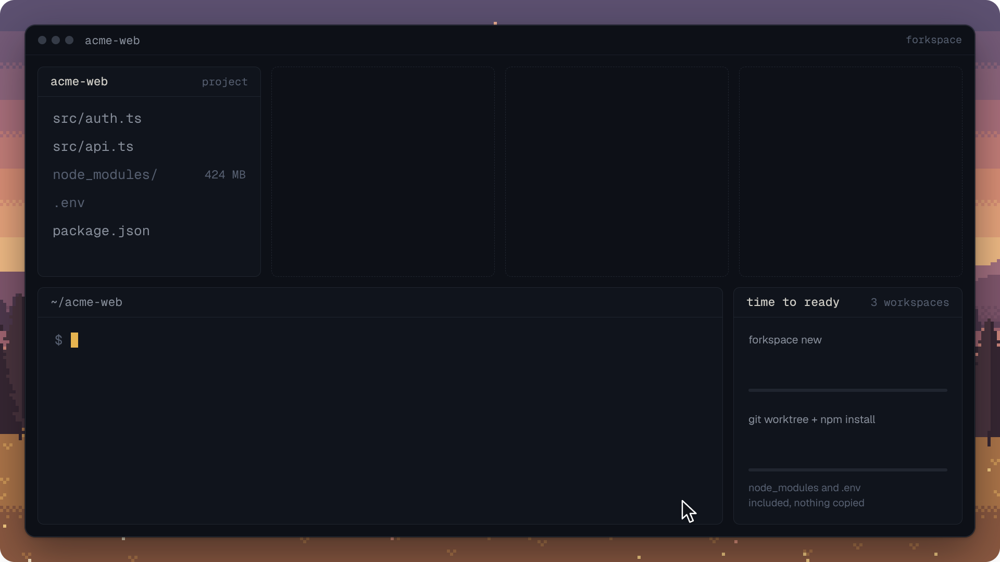
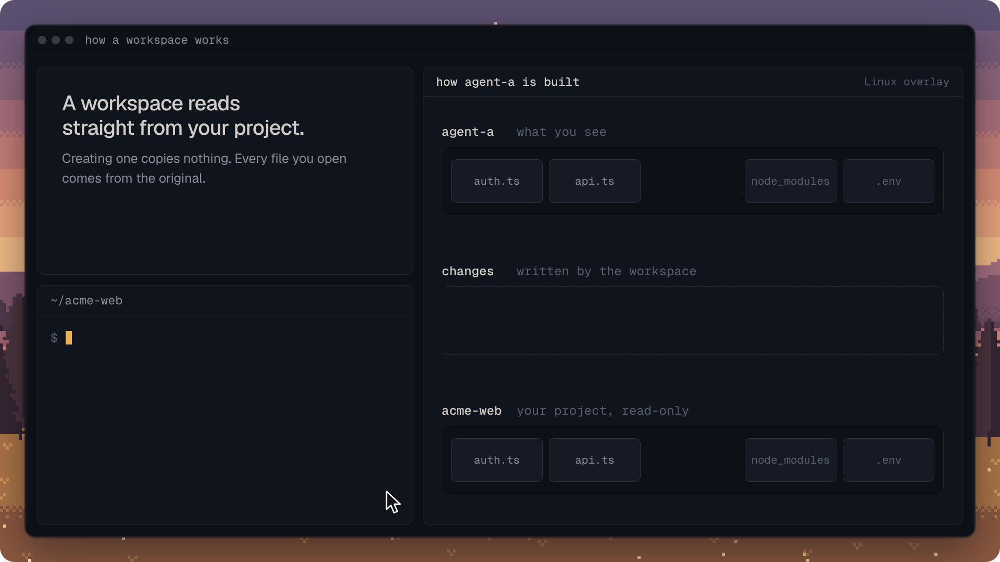
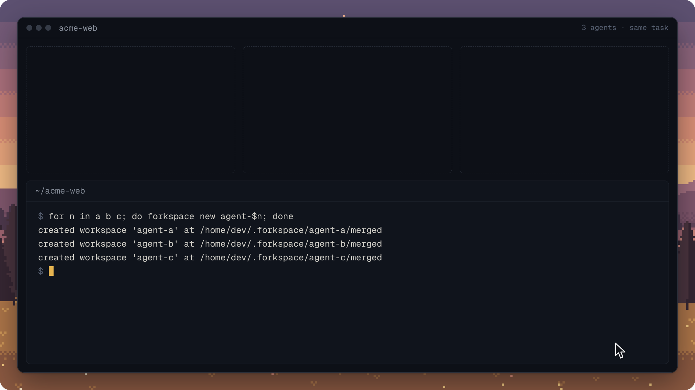
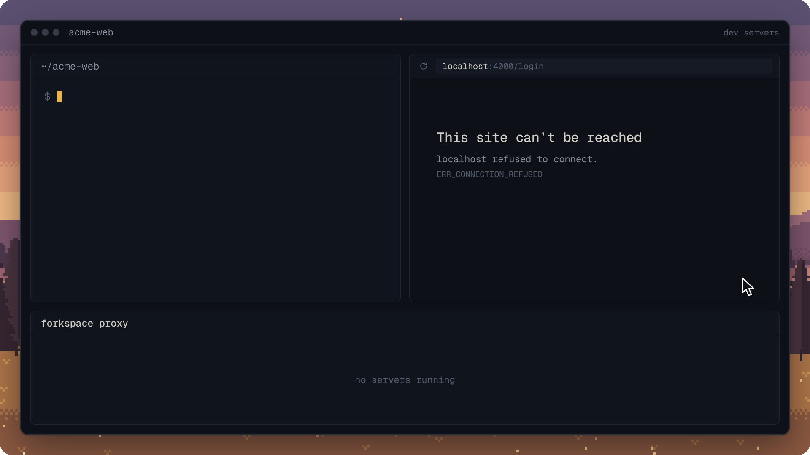

<h1 align="center">
  <picture>
    <source media="(prefers-color-scheme: dark)" srcset="assets/logo/logo-dark.svg" />
    
  </picture>
</h1>

<p align="center">
  <strong>Disposable copies of your whole project, for agents, experiments and parallel work.</strong><br />
  Fork a directory, change anything in it, then merge the result back or throw it away.
</p>

<p align="center">
  <a href="https://crates.io/crates/forkspace"></a>
  <a href="LICENSE"></a>
  <a href="#platforms"></a>
  <a href="#install"></a>
</p>

<p align="center">
  <br />
  <sub>Timings measured on a Next.js 15 app with a 424 MB <code>node_modules</code>. <a href="docs/benchmarks.md#measured-linux-overlay-on-a-real-project">How</a>.</sub>
</p>

## Why forkspace?

A workspace is a full view of your project, including the files Git ignores: `node_modules`,
build caches, `.env`. Changes stay inside the workspace until you merge them, and the original
directory is never touched in the meantime. Forkspace picks the fastest way your filesystem
offers to make that copy: an overlay, an APFS clone, reflinks, or a plain copy as the floor.

|                         |  `cp -r`  |  Docker   | Git worktree |   **forkspace**   |
| :---------------------- | :-------: | :-------: | :----------: | :-----------: |
| **Speed**               |   Slow    |   Slow    |     Fast     | [**Backend-dependent**](docs/benchmarks.md) |
| `.env` / `node_modules` |    Yes    |    No     |      No      | [**Yes**](docs/platform-parity.md) |
| **Isolation**           |   Full    |   Full    |   Partial    | [**Project-local**](docs/platform-parity.md#limitations) |
| **Disk usage**          | Full copy | Full copy |   Partial    | [**CoW or disclosed copy**](docs/platform-parity.md) |
| **Root required**       |    No     |   Often   |      No      | [**No**](docs/platform-parity.md) |
| **Cleanup**             |  Manual   |  Manual   |    Manual    | [`forkspace drop`](docs/cli-reference.md) |

## Quick start

```bash
forkspace new experiment            # an isolated workspace of this directory
forkspace enter experiment -- sh -c 'echo "new idea" >> file.txt'

forkspace diff experiment           # what changed
forkspace diff experiment --full    # the same, as a unified diff

forkspace merge experiment          # apply the changes to the original
forkspace drop experiment           # remove the workspace
```

Run `forkspace enter experiment` without a command to open a shell inside the workspace.

## Install

<!-- notest: installation is networked; docs CI installs this checkout with cargo install --path -->
```bash
# a prebuilt binary for Linux or macOS (x86_64 or arm64), into ~/.local/bin
curl -fsSL https://github.com/berezovyy/forkspace/releases/latest/download/install.sh | sh

# or build it from source with Cargo
cargo install forkspace

# later: move to the newest release (or `forkspace upgrade 0.2.0` for a given one)
forkspace upgrade
```

Forkspace runs on Linux and macOS and needs no root or daemon. On Linux, install
[`fuse-overlayfs`](https://github.com/containers/fuse-overlayfs) for the fastest forks.
`forkspace upgrade` replaces a downloaded binary in place, and a Cargo install through Cargo;
workspaces made by an older version keep working. Releases and their notes are on the
[releases page](https://github.com/berezovyy/forkspace/releases), and in
[CHANGELOG.md](CHANGELOG.md).

## How it works

<p align="center">
  
</p>

On Linux with `fuse-overlayfs`, a workspace is a union of two layers:

- **A frozen copy of your project** is the read-only lower layer. The first fork of a project
  copies it once into `FORKSPACE_HOME` (reflinks on Btrfs and XFS, a plain copy on ext4);
  later forks reuse that copy, or hard-link its unchanged files into a new one, so a branch
  switch or commit in your project never reaches a running agent. Forkspace never writes to
  your project until you merge.
- **The changes layer** starts empty. A file is copied into it the first time it is written,
  new files land there, and deletions are recorded as markers.
- **The workspace** is what you see: the changes layer on top of your project.

Because every change lives in that one layer, `diff` reads it directly, `merge` applies it to
your project, and `drop` deletes it.

APFS clones, reflinks and the plain-copy floor create an ordinary directory instead, and track
changes against a manifest written at fork time. The commands and their output are the same on
every backend; see [Platforms](#platforms).

## Where to use it

### Parallel AI agents

<p align="center">
  
</p>

Give each agent its own workspace of the same repository. They can install packages, run
tests and edit the same files without stepping on each other or on you. When they are done,
compare the attempts and keep the best one.

```bash
for n in a b c; do forkspace new agent-$n; done

# Start one agent per workspace, e.g. `forkspace enter agent-a -- <your agent>`.
forkspace enter agent-a -- sh -c 'echo "export const otp = true;" > src/otp.ts'

forkspace compare agent-a agent-b agent-c   # what each attempt touched
forkspace merge agent-a                     # keep one
forkspace drop --all                        # discard the rest
```

### Dev servers side by side

<p align="center">
  
</p>

Each workspace runs its own dev server on its own port. A small proxy on `localhost:4000`
serves whichever one you switch to, so you can compare branches in one browser tab without
restarting anything.

<!-- notest: starts long-running host services; the proxy integration suite executes this lifecycle -->
```bash
forkspace new feature-a
forkspace new feature-b

forkspace run feature-a -- npm run dev    # gets $PORT=3000
forkspace run feature-b -- npm run dev    # 3000 is taken: gets a free port from 5501

forkspace switch feature-a                # localhost:4000 → feature-a
forkspace switch feature-b                # localhost:4000 → feature-b
```

### Throwaway experiments

Try a risky upgrade, a large refactor or a destructive script without cleaning up afterwards.
An ephemeral workspace is removed as soon as its command or shell exits.

```bash
forkspace enter --ephemeral -- make test
```

### Stacked changes

Start a workspace from another workspace to build in steps, and review everything from the
original project to the top of the stack at once.

```bash
forkspace new step-1
forkspace new step-2 --from step-1
forkspace diff step-2 --cumulative
```

## Commands

| Command   | What it does                                                                |
| :-------- | :-------------------------------------------------------------------------- |
| `new`     | Create a workspace from a directory or another workspace (`--from`, `--branch`, `--copy`) |
| `enter`   | Open a shell or run a command in a workspace (`--ephemeral`, `--merge-on-exit`) |
| `diff`    | Show what changed (`--stat`, `--full`, `--files`, `--json`, `--cumulative`) |
| `compare` | Compare parallel attempts by source, dependency and test changes           |
| `merge`   | Apply a workspace's changes to its base (`--commit`, `--patch`, `--drop`)   |
| `pull`    | Bring new base changes into a workspace                                     |
| `land`    | Bring a workspace's Git branch and commits into the base repository         |
| `run`     | Start a dev server in a workspace behind the `localhost:4000` proxy        |
| `switch`  | Point the proxy at another workspace's dev server                          |
| `checkpoint`, `restore` | Save a workspace's state and return to it later              |
| `ls`      | List workspaces: backend, changed files, disk use, processes                |
| `limit`   | Cap a workspace's memory and CPU (Linux)                                    |
| `drop`    | Remove workspaces (`--kill`, `--all`, `--glob`, `--force`)                  |
| `gc`      | Show and reclaim disk forkspace no longer needs                             |
| `upgrade` | Install the latest release, or a given version (`--check`)                  |

Every command has `--help`; `ls`, `diff`, `compare`, `pull` and `checkpoints` also print
`--json`. The full reference is in [docs/cli-reference.md](docs/cli-reference.md), and the rest
of the docs are listed in [docs/README.md](docs/README.md).

## Platforms

Forkspace probes the filesystem and uses the fastest backend that works. The choice is
recorded per workspace.

| Platform | Backend                        | Forking                                   |
| :------- | :----------------------------- | :---------------------------------------- |
| Linux    | `fuse-overlayfs`               | Nothing is copied; changes go to a layer  |
| Linux    | Reflinks (e.g. Btrfs, XFS)     | Files share blocks until they are written |
| macOS    | APFS clones                    | The directory is cloned copy-on-write     |
| Both     | Plain copy (`--copy`)          | A full copy, reported when it happens     |

Measured numbers are in [docs/benchmarks.md](docs/benchmarks.md), and the behaviour and
limitations of each backend in [docs/platform-parity.md](docs/platform-parity.md).

## License

[MIT](LICENSE)
